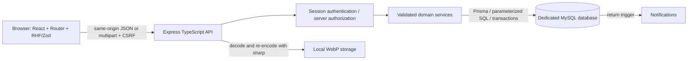

# Architecture and API

Development: Vite :5173 proxies API/uploads to Express :4000. Compiled mode: Express serves `client/dist`. Runtime process binds loopback; an HTTPS reverse proxy is required for production. There is no separate service for sessions or notifications.

## Contracts

Success: `{ "data": ... }`, with paginated collections additionally returning `meta: { page, pageSize, total, pages }`. Notifications also return `meta.unread`. Errors: `{ "error": { "message": "...", "fields": { ... } } }`; fields is present for validation failures. Codes: 200 normal, 201 created, 400 invalid body/upload, 401 unauthenticated, 403 role/origin/CSRF denied, 404 not found, 409 conflict/constraint, 429 rate limited, 503 unavailable database/unexpected failure. All JSON API responses disable caching. Page size defaults to 12, maximum 50; page maximum 10000.

Every unsafe request needs `Origin: APP_ORIGIN`, an HTTP-only CSRF cookie, and `X-CSRF-Token` equal to the token from `GET /api/auth/csrf`. The browser wrapper handles these automatically. Multipart item writes use a single `image` field. JSON writes use Content-Type application/json. GET requests do not mutate domain state; CSRF bootstrap sets its cookie only.

## REST overview

| Method / path (all `/api`) | Access / behavior |
|---|---|
| GET `/health` | Public, database connectivity |
| GET `/auth/csrf` | Public, return token and set HTTP-only CSRF cookie |
| POST `/auth/register` | Student signup; fullName, email, password, confirmPassword |
| POST `/auth/login` | Email/password; issue opaque session cookie |
| POST `/auth/logout` | Authenticated; delete server session, clear cookie |
| GET `/auth/me` | Own safe profile |
| GET `/stats` | Public database counts |
| GET `/categories` | Public categories and open-item counts |
| GET `/items` | Public filters: q, type, categoryId, location, status, sort; page/pageSize |
| GET `/items?mine=true` | Authenticated, own items including withdrawn |
| GET `/items/:id` | Public details; private identifiers only to reporter/admin |
| POST `/items` | Authenticated, JSON or multipart report |
| PATCH `/items/:id` | Reporter only, OPEN without claims; full validated item payload |
| DELETE `/items/:id` | Reporter, eligible OPEN item; soft withdrawal |
| GET `/items/:id/claims` | Reporter sees workflow metadata only; admin sees evidence; paginated |
| POST `/claims` | Authenticated, private proof on another user's OPEN found item |
| GET `/claims/mine` | Own claims/evidence/review notes, paginated |
| GET `/dashboard` | Own item counts, pending claims, 10 activity rows |
| GET `/notifications` | Recipient-only, paginated |
| PATCH `/notifications/:id/read` | Recipient-only read marking |
| GET `/admin/dashboard` | Admin counts and 15 recent audit records |
| GET `/admin/claims` | Admin evidence, claimant names; status/q filters and pagination |
| PATCH `/admin/claims/:id` | Admin decision APPROVED/REJECTED, optional reviewNote |
| POST `/admin/items/:id/return` | Admin; JSON `{handoverConfirmed:true}` required |
| DELETE `/admin/items/:id` | Admin moderation of OPEN item, reject pending claims |
| POST `/admin/categories` | Admin; name/description |
| PATCH `/admin/categories/:id` | Admin; name/description |
| DELETE `/admin/categories/:id` | Admin; only unused category |
| GET `/admin/users` | Admin; q matches name/email; paginated safe profiles |
| PATCH `/admin/users/:id` | Admin; `{isActive:boolean}` for student accounts only |

## Authentication flow

RHF validates for usability; the API independently validates with strict Zod schemas. Registration lowercases email, hashes with bcrypt cost 12, writes a STUDENT and audit row, then creates a session. A cryptographically random 256-bit token is sent in an HTTP-only cookie; only its SHA-256 hash is stored with expiry in MySQL. Each authenticated request joins the session to the current user and checks expiry/activation and current role. Logout deletes the hash; deactivation deletes all that student's sessions. Login uses a dummy bcrypt comparison for unknown email and never discloses whether the email exists. An administrator is provisioned only through the explicit CLI script.

## Claim verification flow

1. Claimant sends private explanation, identifiers and optional supporting information.
2. Transaction locks the parent item, rejects own/duplicate/ineligible claims, inserts evidence, notifications and audit.
3. Admin compares reporter identifiers with claimant evidence; self-involved review is blocked.
4. Review transaction locks the same item, rereads claim/item, verifies pending/open state and records review.
5. Approval changes item to VERIFIED and rejects pending competitors; notifications/audit are committed together. A database functional unique index prevents multiple approved claims.
6. After physical handover, a second explicit admin request locks the item, checks approved claim and VERIFIED state, and sets RETURNED. The database trigger notifies the reporter; the service notifies the claimant and logs the action.
7. Any failure rolls back the workflow, including trigger effects. Concurrent updates serialize at the item lock; stale requests receive 409.

Private evidence stays in My claims / admin evidence views. Reporters see claim IDs/status/times without claimant proof/contact details. Public item projections never include user contact data or private identifiers.
