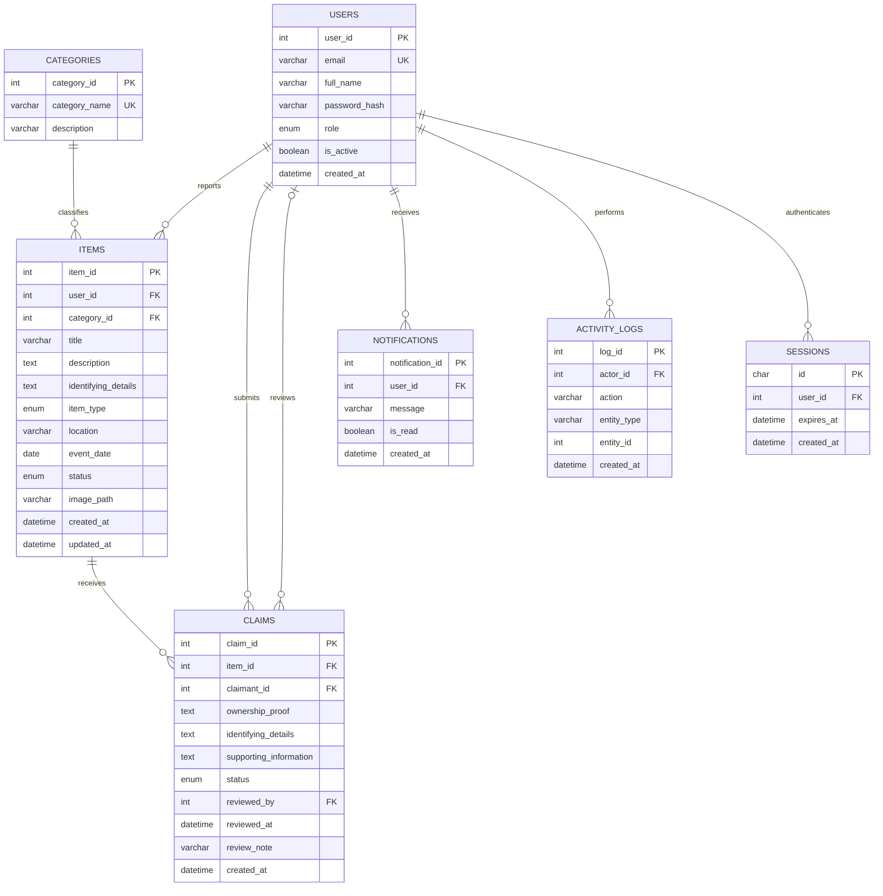
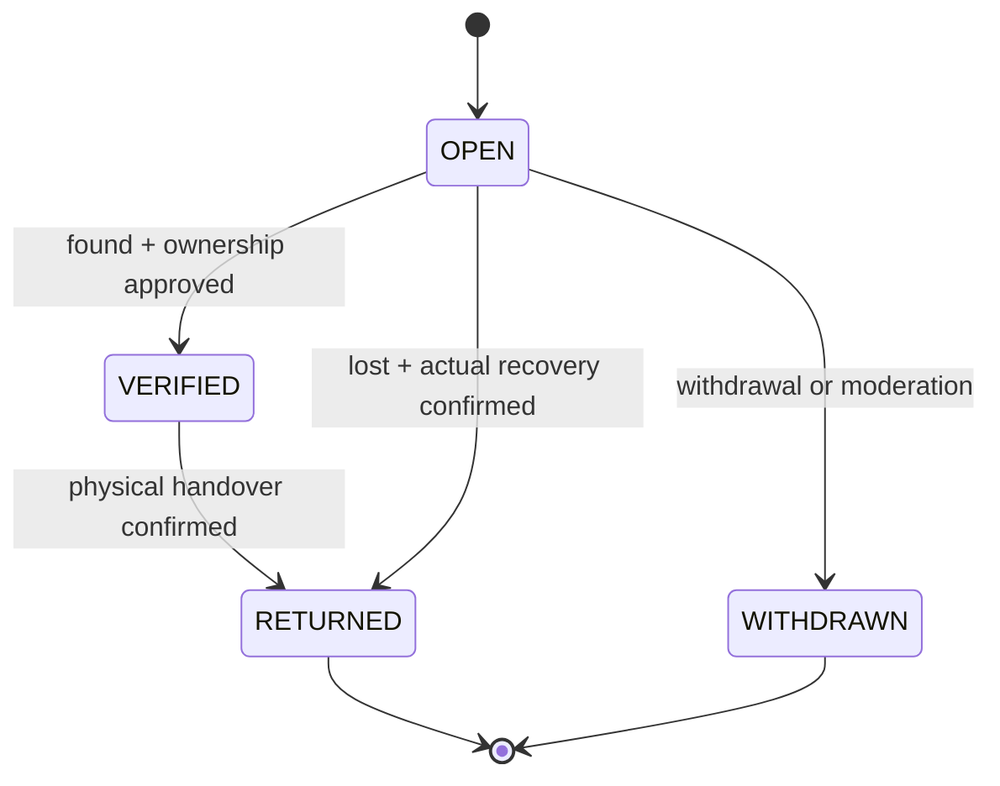

# Database design

Six domain tables are in 3NF; `sessions` is an additional authentication infrastructure table. Prisma maps camelCase names to the SQL names below. InnoDB, utf8mb4, UTC timestamps and calendar DATE event values are used.

## ER diagram

## Relational schema and cardinalities

`users(user_id PK, email UNIQUE, full_name, password_hash, role, is_active, created_at)`

`categories(category_id PK, category_name UNIQUE, description)`

`items(item_id PK, user_id FK→users, category_id FK→categories, title, description, identifying_details?, item_type, location, event_date, status, image_path?, created_at, updated_at)`

`claims(claim_id PK, item_id FK→items, claimant_id FK→users, ownership_proof, identifying_details, supporting_information?, status, reviewed_by? FK→users, reviewed_at?, review_note?, created_at; UNIQUE(item_id,claimant_id))`

`notifications(notification_id PK, user_id FK→users, message, is_read, created_at)`

`activity_logs(log_id PK, actor_id FK→users, action, entity_type, entity_id, created_at)`

`sessions(id PK, user_id FK→users, expires_at, created_at)`

A user reports many items; each item has one reporter and category. An item receives many claims; each claim has one claimant and zero or one reviewer. Users receive many notifications and own many activity/session records. Audit entity_id is a logical reference to multiple entity types; actor_id is a real FK. Audit rows record action/entity identifiers only.

## Data dictionary

Integer PKs are `INT AUTO_INCREMENT`; FK columns are `INT`. All timestamps are `DATETIME(3)`. `?` marks nullable fields.

| Table | Columns | Definition |
|---|---|---|
| users | user_id | Integer PK |
| users | full_name, email | VARCHAR(100), unique VARCHAR(254); normalized lowercase email |
| users | password_hash | VARCHAR(255), bcrypt cost 12 |
| users | role, is_active, created_at | ENUM STUDENT/ADMIN; BOOLEAN true; creation time |
| categories | category_id, category_name, description | PK; unique VARCHAR(60); VARCHAR(255) |
| items | item_id, user_id, category_id | PK; reporter FK; category FK |
| items | title, description, identifying_details? | VARCHAR(120); public TEXT; private TEXT |
| items | item_type, status | ENUM LOST/FOUND; ENUM OPEN/VERIFIED/RETURNED/WITHDRAWN |
| items | location, event_date, image_path? | VARCHAR(160); DATE; server-generated VARCHAR(255) WebP path |
| items | created_at, updated_at | Creation time; Prisma-maintained update time |
| claims | claim_id, item_id, claimant_id | PK; item FK; claimant FK |
| claims | ownership_proof, identifying_details, supporting_information? | Private TEXT explanation, identifiers and optional evidence |
| claims | status, reviewed_by?, reviewed_at? | ENUM PENDING/APPROVED/REJECTED; reviewer FK; review time |
| claims | review_note?, created_at | VARCHAR(500) claimant-visible note; submission time |
| notifications | notification_id, user_id | PK; recipient FK |
| notifications | message, is_read, created_at | VARCHAR(500); BOOLEAN false; creation time |
| activity_logs | log_id, actor_id | PK; actor FK |
| activity_logs | action, entity_type, entity_id, created_at | VARCHAR(60); VARCHAR(30); INT logical key; time |
| sessions | id, user_id, expires_at, created_at | CHAR(64) SHA-256 token hash PK; user FK; expiry; creation time |

## Normalization

**1NF:** Scalar cells, primary keys, no repeated groups. Claims are rows rather than lists inside items. Free-text descriptions are scalar documents.

**2NF:** Single-column surrogate primary keys identify entities. Every non-key attribute describes the whole entity/relationship. The alternate composite claim key identifies one student's claim on one item.

**3NF:** Category names/descriptions live only in categories; user identity lives only in users; claims reference users/items instead of copying names/emails/titles. Counts are computed rather than stored. No non-key attribute in these entities determines another non-key attribute. Item status describes physical/workflow progress; claim status describes a verification decision, so these are distinct facts maintained atomically. Notification text is a point-in-time message. Location is a simple label; a separate location entity is needed only if metadata such as buildings/rooms is introduced.

## Integrity and performance

- Domain foreign keys use ON DELETE RESTRICT to preserve audit/claim history. Sessions use CASCADE. The application never deletes users. Default ON UPDATE CASCADE preserves references, although IDs never change through the API.
- Unique email/category keys and unique `(item_id,claimant_id)` prevent duplicates, including repeated claims after rejection.
- A functional unique index on `CASE WHEN status='APPROVED' THEN item_id ELSE NULL END` permits many unapproved claims and only one approved claim per item, even if SQL bypasses the API.
- CHECKs require a review timestamp for decided claims and prohibit VERIFIED lost reports. MySQL disallows checking reviewed_by under these referential actions; the service sets reviewer and timestamp together, and the FK validates reviewer existence.
- Item indexes cover `(item_type,status,created_at)`, `(category_id,created_at)`, `(user_id,status)`, location and event date. Claims index status/time and claimant/time; notifications index user/unread/time. `%substring%` search is simple and does not fully benefit from a B-tree; introduce FULLTEXT only after measuring need.
- `public_item_summary` joins categories and counts claims without contacts or evidence. The API uses equivalent explicit projections; the view supports academic reporting and is directly tested.
- `notify_reporter_on_return` inserts a notification after a transition to RETURNED. It runs inside the transaction; rollback removes it too. The service separately notifies the verified claimant.
- View, functional index, trigger and CHECKs are maintained in migration `202610200002_integrity`, beyond Prisma's schema model. Do not replace migrations with `prisma db push` or drop functional indexes during introspection.

## Transactions and transitions

Every item/claim writer locks the parent item first with `SELECT ... FOR UPDATE` in a READ COMMITTED transaction. Consistent lock order serializes per-item decisions. Review checks current state after locking. Approval, competing-claim rejection, VERIFIED status, notifications and audit commit together. Handover locks the same row, requires an approved claim for found items, and changes to RETURNED. Lost reports may be resolved by an admin after actual recovery. The API requires explicit handover acknowledgement. Services enforce domain transitions; SQL operators remain trusted administrators.

